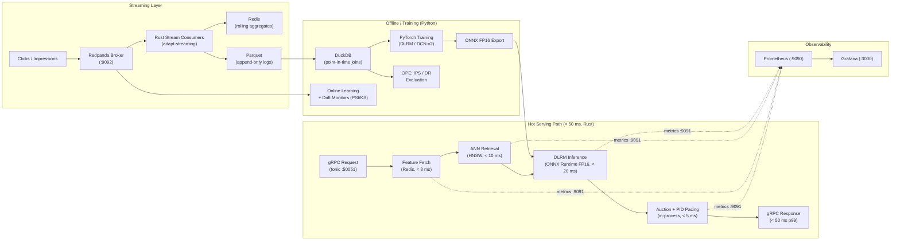

# ADAPT: Architecture & Engineering Details

> Comprehensive technical design, architectural patterns, latency budgets, hardware sizing, and subsystem breakdown for the ADAPT real-time ad decisioning and ranking platform.

---

## 🏛️ System Architecture

ADAPT is built around a two-language decoupled design to achieve predictable sub-millisecond execution on the serving hot path while leveraging Python for model training and counterfactual evaluation:

---

## ⚡ Latency Budgets (< 50 ms p99 SLA)

| Stage | Budget | Technology / Mechanism |
|---|---|---|
| **Request parsing & feature fetch** | < 8 ms | In-memory Redis pipelined reads with connection pooling |
| **Two-tower candidate retrieval** | < 10 ms | Embedded HNSW vector traversal with predicate pushdown |
| **Deep ranking inference (DLRM/DCN)** | < 20 ms | In-process ONNX Runtime FP16 with dynamic batching |
| **Bidding, pacing & auction** | < 5 ms | In-process Rust arithmetic (GSP/VCG + PID spend multiplier) |
| **Buffer / network overhead** | < 7 ms | Zero-copy serialization (Protobuf / gRPC) |
| **Total End-to-End** | **< 50 ms** | Guaranteed via circuit breakers & heuristic fallback |

---

## 🛠️ Subsystem-by-Subsystem Breakdown

### 1. Two-Tower Candidate Generation (ANN Index)
- **Problem**: Narrowing a pool of 100k+ candidate ads down to top 500 in `< 10 ms`.
- **Solution**: Decoupled dual neural encoders (PyTorch). Item embeddings indexed into in-process HNSW index (`instant-distance`). Hard targeting predicates (geo, device, age) pushed down into traversal to prevent post-filter candidate starvation.

### 2. Multi-Task Deep Ranking (DLRM / DCN-v2) & Calibration
- **Problem**: Estimating $p\text{CTR}$ and $p\text{CVR}$ over 500 candidates in `< 20 ms`.
- **Solution**: Explicit sparse-dense feature interaction layers executed in-process via ONNX Runtime (`ort`) with FP16 precision and dynamic batching.
- **Probability Calibration**: Platt scaling / isotonic regression on held-out validation sets to minimize Expected Calibration Error (ECE), preventing advertiser overbidding.

### 3. Closed-Loop PID Budget Pacing & Auction Resolution
- **Problem**: Enforcing finite 24-hour campaign budgets without premature exhaustion or under-delivery.
- **Solution**: Discrete PID controller modulating bid multipliers:
  $$u(t) = K_p e(t) + K_i \int e(\tau)d\tau + K_d \frac{de(t)}{dt}$$
  Coupled with Generalized Second Price (GSP) and Vickrey–Clarke–Groves (VCG) auction mechanics with reserve pricing floors.

### 4. Streaming Feature Store (Redis + Redpanda)
- **Problem**: Preventing training-serving skew between real-time inference and offline training.
- **Solution**: Dual-store architecture. Redpanda streams event logs; custom Rust consumers compute rolling window aggregates (5m, 1h, 24h counters) written atomically to Redis. Offline DuckDB materializes historical snapshots via point-in-time ASOF temporal joins.

### 5. Drift Detection & Off-Policy Evaluation (OPE)
- **Monitors**: Continuous Population Stability Index (PSI) and Kolmogorov-Smirnov (KS) tests between inference logs and baseline training data to trigger automated rollbacks when PSI > 0.25.
- **OPE Framework**: Inverse Propensity Scoring (IPS) and Doubly Robust (DR) estimators evaluating counterfactual models without risky production traffic exposure.

---

## 💻 Hardware Profiles & Sizing

| Parameter | Portfolio Target (RTX 3050 6GB) | Production Scale (A10G / L4 Clusters) |
|---|---|---|
| **User Vocabulary** | 100,000 entities | $10^8 - 10^9$ entities |
| **Ad / Creative Vocabulary** | 50,000 entities | $10^6 - 10^7$ entities |
| **Embedding Dimension ($d$)**| 64 | 128 – 256 |
| **Candidate Pool (ANN)** | 100,000 items (~25 MB RAM) | $10^7$ items (Distributed cluster) |
| **Training Batch Size** | 256 – 512 | 4,096 – 16,384 |
| **Scored Candidates / Req**| 500 candidates | 500 – 1,000 candidates |
| **Throughput Target** | 200 – 500 QPS sustained | 1,000 – 10,000+ QPS |
| **Latency SLA** | **< 50 ms p99 (Demonstrated)** | **< 50 ms p99 (Sustained at Scale)** |

