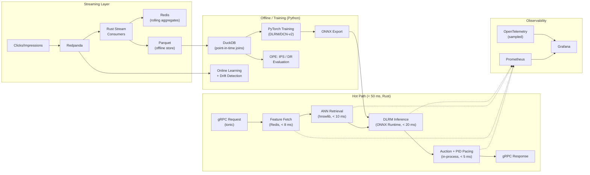

# ADAPT: Technology Stack & Local Hardware Profile

> [!IMPORTANT]
> ADAPT's defining constraint is **< 50 ms p99 end-to-end latency at 1,000+ QPS** (200–500 QPS demonstrated locally). Every technology choice below is driven by this requirement. Anything that adds garbage collection pauses, serialization overhead, or out-of-process network round-trips in the hot path is disqualified.

---

## Recommended Primary Language

### **Rust** (with Python for ML training only)

| Concern | Why Rust wins for ADAPT |
|---|---|
| Latency determinism | No GC pauses. You need predictable sub-millisecond per-stage budgets (8 ms Redis fetch, 10 ms ANN, 20 ms inference, 5 ms auction). GC stop-the-world events in Go/Java/C# blow your p99. |
| Throughput | Zero-cost abstractions + `tokio` async runtime gives you high QPS without thread-per-request overhead. |
| ONNX Runtime interop | Rust has first-class `ort` bindings to ONNX Runtime C API — run your DLRM/DCN-v2 with FP16/dynamic batching directly in-process, no gRPC hop to a sidecar. |
| Memory safety | You're running a system that handles real money (ad budgets). Use-after-free or data races in the pacing controller = silent budget drain. Rust eliminates this class of bugs at compile time. |
| Ecosystem maturity for this domain | `tonic` (gRPC), `redis-rs` (async Redis), `rdkafka` (librdkafka wrapper), `hnsw` / `hora` (ANN), `ndarray` (numerics). |

> [!NOTE]
> **Python stays in the loop** — but only for the offline/batch ML path: training DLRM/DCN-v2 models in PyTorch/TensorFlow, exporting to ONNX, Platt scaling/isotonic calibration, offline OPE evaluation (IPS/DR estimators), and notebook-driven analysis. Python never touches the hot serving path.

### Honorable Mention: **C++**
The industry standard (Google Ads, Meta). Equivalent performance to Rust, but higher development velocity risk (memory bugs, build system pain). Choose C++ only if you're targeting a team that already has a C++ stack.

### Why Not Go?
Go is excellent for networked microservices but its GC pauses (typically 0.5–2 ms, occasionally more under heap pressure) are unacceptable when your *entire auction resolution budget is 5 ms*. Go is fine for surrounding infrastructure (dashboards, config services), not the hot path.

---

## Subsystem-by-Subsystem Stack

### 1. Candidate Generation (Two-Tower ANN)

| Component | Technology | Rationale |
|---|---|---|
| Embedding training | **PyTorch** | Two-tower dual encoder training with negative sampling. Export to ONNX. |
| ANN index | **HNSW via `hnswlib`** (embedded, C++ with Rust FFI) or **Faiss (IVF-PQ)** | In-process vector search, no network hop. HNSW for < 10M items (pure speed); IVF-PQ for > 10M (memory efficiency). |
| Hard filtering | Custom bitset intersection during ANN traversal | Push targeting predicates (geo, device, age) into the search loop to avoid post-filter candidate starvation. |

> [!TIP]
> Embed the ANN index **in-process** rather than calling an external vector DB. An external service adds 2–5 ms network latency that eats half your 10 ms ANN budget.

### 2. Deep Ranking Inference

| Component | Technology | Rationale |
|---|---|---|
| Model architecture | **DLRM / DCN-v2** (PyTorch training) | Industry-standard for sparse + dense feature interaction in adtech. |
| GBDT baseline | **LightGBM** | Fast training, interpretable, calibration benchmark. |
| Serving runtime | **ONNX Runtime** (in-process via Rust `ort` crate) | FP16 inference, dynamic batching, < 20 ms budget. Avoids Triton's gRPC overhead. |
| Calibration | **Platt scaling / Isotonic regression** (scikit-learn, offline) | Applied as a lightweight post-processing lookup table in the serving path. |

> [!WARNING]
> Do **not** use Triton Inference Server unless you need multi-GPU model serving. Triton adds a gRPC hop (2–5 ms) that you can't afford. ONNX Runtime in-process is the right call for single-node ADAPT.

### 3. Streaming Feature Store

| Component | Technology | Rationale |
|---|---|---|
| Online store | **Redis** (or **DragonflyDB** for higher throughput) | Sub-millisecond key-value lookups for real-time feature vectors and rolling aggregates. |
| Event streaming | **Redpanda** (preferred) or **Kafka** | Redpanda: C++ rewrite of Kafka, lower tail latency, no JVM. Same protocol, drop-in replacement. |
| Stream processing | **Custom Rust consumers** (not Flink/Spark) | Rolling window aggregates (clicks in last 5m/1h/24h) are simple enough that a custom stateful consumer avoids the operational overhead of a JVM streaming framework. |
| Offline store | **DuckDB** + **Parquet** files | Point-in-time correct training dataset generation with temporal joins. DuckDB's columnar engine handles this natively. |
| Feature registry | **Simple YAML/TOML config** (no Feast) | Feast adds complexity without enough value at this scale. Define features declaratively, validate with CI. |

### 4. Bidding Engine & PID Pacing Controller

| Component | Technology | Rationale |
|---|---|---|
| Auction engine | **Rust** (pure compute, in-process) | GSP/VCG auction logic is CPU-bound math. No external dependencies needed. |
| PID controller | **Rust** (in-process, stateful) | PID state (integral term, derivative) must be in-process for < 5 ms budget. Gains ($K_p$, $K_i$, $K_d$) tuned offline. |
| RL pacing agent | **Contextual bandit** (trained in Python, served as ONNX or lookup table) | Lightweight LinUCB or neural bandit. Export policy to a lookup table or small ONNX model. |
| Budget state | **Redis** (atomic increments) | Campaign spend counters with `INCRBY` for atomic cross-request budget tracking. |

### 5. Online Learning & Drift Detection

| Component | Technology | Rationale |
|---|---|---|
| Online weight updates | **Custom Rust/Python hybrid** | Consume conversion events from Redpanda, compute gradient updates, push to model checkpoint store. |
| Drift detection | **Rust** (in-process statistics) | PSI and KS test computations are simple histogram comparisons. Run them on inference log samples. |
| Model checkpoint store | **Object storage (S3/MinIO)** + **Redis** (active model pointer) | Atomic model swaps via Redis pointer update. Rollback = point to previous checkpoint. |
| Delayed feedback handling | **Python** (offline calibration window adjustment) | Importance-weighted hazard models for conversion delay correction. Runs in batch, not real-time. |

### 6. Off-Policy Evaluation (OPE)

| Component | Technology | Rationale |
|---|---|---|
| IPS / DR estimators | **Python** (NumPy/Pandas) | Offline analysis. Compute $\hat{R}_{\text{IPS}}$ and Doubly Robust estimates on logged interaction data. |
| Logging pipeline | **Redpanda → Parquet** | Log every impression with propensity scores ($P_0(a_i \mid x_i)$) for counterfactual evaluation. |
| A/B simulation | **Python** + **DuckDB** | Synthetic A/B test simulations comparing OPE predictions against ground truth. |

### 7. Serving Infrastructure & Observability

| Component | Technology | Rationale |
|---|---|---|
| API protocol | **gRPC** (via `tonic` in Rust) | Binary serialization (protobuf), streaming, HTTP/2 multiplexing. Standard in adtech. |
| Load balancing | **Envoy** or direct **TCP** | If deploying multiple replicas. For single-node ADAPT, unnecessary. |
| Circuit breakers | **Custom Rust** (in-process) | Per-stage timeout enforcement with fallback to cached GBDT ranker. Tower middleware pattern. |
| Metrics | **Prometheus** (via `metrics` crate) | p50/p90/p99/p99.9 latency histograms, per-stage breakdowns, QPS counters. |
| Tracing | **OpenTelemetry** (lightweight, sampled) | Distributed tracing for debugging latency regressions. Sample at 1% in production. |
| Dashboards | **Grafana** | Latency dashboards, budget pacing curves, drift monitor alerts. |

---

## Architecture Diagram

---

## Summary: The Two-Language Split

| Path | Language | What runs here |
|---|---|---|
| **Hot serving path** | **Rust** | gRPC server, Redis client, ANN search, ONNX inference, auction engine, PID controller, circuit breakers, metrics emission |
| **Offline / training path** | **Python** | PyTorch model training, ONNX export, Platt/isotonic calibration, OPE evaluation, drift analysis notebooks, data pipeline orchestration |

> [!CAUTION]
> The single biggest mistake would be writing the hot path in Python (even with async). At 1,000 QPS with a 50 ms budget, Python's GIL and interpreter overhead make it impossible to hit p99 targets. The hot path must be compiled, zero-GC, and in-process.

---

## Alternative: If You Want to Move Faster (Acceptable Tradeoffs)

If development velocity matters more than squeezing every microsecond:

| Swap | From | To | Tradeoff |
|---|---|---|---|
| Hot path language | Rust | **C++ or Go** | C++: equivalent perf, harder to maintain. Go: ~2–5 ms GC penalty, may blow p99 under load. |
| ANN index | In-process hnswlib | **Milvus / Qdrant** (external) | Adds 2–5 ms network hop. Only if you need distributed vector search. |
| Inference runtime | In-process ONNX | **Triton Inference Server** | Adds gRPC hop, but gives you multi-model serving, GPU sharing, and A/B model routing for free. |
| Stream processing | Custom Rust consumers | **Flink** | Richer windowing semantics, but JVM operational overhead. |

---

## Hardware Profile & Local Execution Constraints (RTX 3050 6GB Laptop GPU)

### Feasibility Verdict: **Fully Feasible for Portfolio-Grade Verification**

The full ADAPT system can run locally on an **NVIDIA GeForce RTX 3050 Laptop GPU (6 GB VRAM)**. Sizing constraints primarily affect offline embedding vocabulary sizes and sustained QPS load, but do not compromise per-request SLA verification (< 50 ms p99) or architectural realism.

### Subsystem Resource Allocation

| Subsystem | Primary Resource | RTX 3050 6GB Footprint |
|---|---|---|
| **gRPC Gateway (`tonic`)** | CPU | Multi-threaded async Tokio runtime. |
| **ANN Candidate Retrieval (`hnswlib`)** | System RAM | In-process; 100k vectors × 64-dim takes ~25 MB system RAM. |
| **Feature Store (Redis / DragonflyDB)** | System RAM | In-memory key-value cache (~1–2 GB system RAM). |
| **Event Streaming (Redpanda)** | CPU / SSD | Single-node broker, zero JVM overhead. |
| **DLRM Inference (`ort` FP16)** | **GPU VRAM** | **~300–500 MB VRAM**; batch of 500 candidates executes in **2–8 ms**. |
| **Offline PyTorch Training** | **GPU VRAM** | **~1.5–2.0 GB VRAM** (with batch size 256–512, vocab 100k users / 50k ads). |
| **Auction & PID Pacing** | CPU | In-process arithmetic (< 1 ms). |
| **DuckDB / Parquet Store** | CPU / SSD | Temporal joins for point-in-time correctness. |

### Sizing Guidelines: Local Portfolio vs. Production Cluster

| Parameter | Local Portfolio Target (RTX 3050 6GB) | Production Scale (A10G / L4 Clusters) |
|---|---|---|
| **User Vocabulary** | 100,000 entities | $10^8 - 10^9$ entities |
| **Ad / Creative Vocabulary** | 50,000 entities | $10^6 - 10^7$ entities |
| **Embedding Dimension ($d$)** | 64 | 128 – 256 |
| **Embedding Table Memory** | ~60 MB | 10s of GB (distributed across parameter servers) |
| **Training Batch Size** | 256 – 512 | 4,096 – 16,384 |
| **Scored Candidates / Req** | 500 candidates | 500 – 1,000 candidates |
| **Throughput Target** | 200 – 500 QPS sustained | 1,000 – 10,000+ QPS |
| **Latency SLA** | **< 50 ms p99 (Demonstrated)** | **< 50 ms p99 (Sustained at Scale)** |

